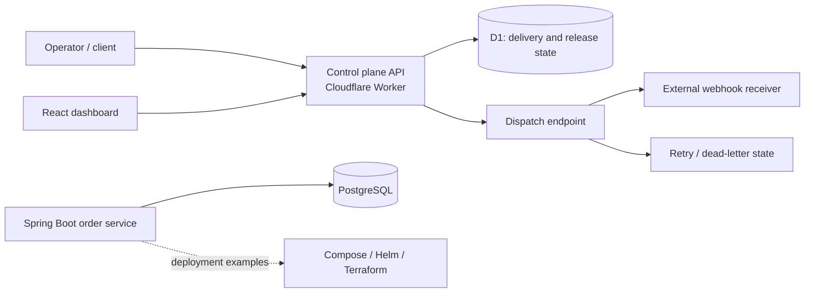

# AdaptiveOps — Event Delivery and Release Controls

AdaptiveOps is a multi-service backend portfolio project exploring reliable webhook delivery and safer application releases. The repository contains a Cloudflare Worker control plane backed by D1, a Spring Boot order workload backed by PostgreSQL, a React dashboard, and deployment examples for local containers and cloud platforms.

## At a glance

- **Problem:** webhook delivery and releases need observable state, retry handling, and an auditable operator workflow.
- **Architecture:** Hono/TypeScript API on Workers + D1; Java/Spring Boot order service + PostgreSQL; React/Vite dashboard.
- **Reliability mechanisms:** status-aware delivery retries, delivery records, dead-letter handling, release health checks, and rollback records.
- **Current evidence:** local control-plane suite (65 tests), TypeScript check, dashboard production build, ShellCheck, Terraform validation, and PostgreSQL Testcontainers concurrency integration are passing. SonarQube configuration is present but requires hosted `SONAR_HOST_URL` and `SONAR_TOKEN`; no hosted run is attached.
- **Readiness:** production readiness is not established. The checks are local evidence, not proof of hosted gate enforcement or production operation.

## Architecture and flow

The control-plane dispatch path is HTTP-triggered: a caller invokes the dispatch endpoint, the Worker reads delivery state, sends the webhook, and records the outcome for retry or dead-letter handling. The repository does not demonstrate a scheduled dispatcher. The Java order service is a separate workload and should not be read as an implementation running inside the Worker.

The release flow records health-check and rollback state. A rollback request creates an `in_progress` deployment record and audit event; it does not itself invoke a platform actuator. The preview deployment script targets an isolated Cloudflare configuration, but this checkout has no verified hosted preview deployment. The production path is not exercised.

## Design decisions and trade-offs

| Decision | Reasoning | Trade-off / failure case |
|---|---|---|
| D1 for control-plane records; PostgreSQL for the Java workload | Use storage aligned to each runtime and service boundary | Cross-service state is not one transaction; operators must handle partial completion and reconcile records |
| Retry based on delivery outcomes, with dead-letter state | Transient receiver failures should not discard work | Delivery is at-least-once in practice; receivers need idempotency, and retry exhaustion needs operator attention |
| Keep the order service separate from the Worker | The repository exercises a conventional Java backend alongside edge control-plane APIs | More deployment and observability surfaces; the examples do not prove they are deployed together |
| Include AWS/Azure Terraform and Helm examples | Show infrastructure direction and deployment modeling | Configuration and plans are not evidence of provisioned or operated infrastructure |

## Repository map

- `control-plane/` — Worker API, delivery and release logic, D1 migrations.
- `order-service/` — Spring Boot order workload and PostgreSQL integration.
- `dashboard/` — React/Vite operator UI.
- `scripts/` — local checks, failure-injection and operational scripts.
- `deploy/` — Compose, Helm and Terraform examples.
- `.github/workflows/` — CI, security checks and Cloudflare workflow.

## CI, security and verification

The repository includes GitHub Actions workflows for Java, TypeScript/dashboard, shell and Terraform checks, plus Trivy and secret scanning. Current `npm audit` reports 15 dependency findings in the control-plane tree (3 critical, 9 high, 3 moderate); supported toolchain upgrades remain necessary. SonarQube Server analysis waits for the quality gate and fails when `SONAR_HOST_URL` or `SONAR_TOKEN` is absent. Local checks completed in this checkout; there are no hosted run links or branch-protection settings, so remote enforcement remains unverified.

The Worker preview configuration passed an offline Wrangler dry run using a placeholder D1 identifier. This validates configuration shape only; it does not prove that Cloudflare secrets, preview resources, or hosted services work.

## Production readiness

| Area | Evidence in this repository | Assessment |
|---|---|---|
| Implementation | Multiple services, D1 migrations, retry/dead-letter logic, health and rollback paths | Substantial implementation; operational behavior still needs end-to-end proof |
| Testing | 65 control-plane tests, one PostgreSQL-backed Java concurrency integration test, dashboard production build | These checks passed locally; full Java suite and hosted results remain unverified |
| Security | SonarQube, Trivy, and secret-scanning workflow definitions | No hosted gate result or evidence of configured branch protection/reviewed findings |
| Deployment | Compose, Helm, Terraform and a Cloudflare workflow | Cloudflare Worker step is dry-run; infrastructure examples are not deployment evidence |
| Operations | Health endpoint and audit/rollback records | One dated health probe is limited evidence; no SLO, alerting, recovery drill or sustained run history established |

**Conclusion:** production readiness has not been demonstrated. The dated health probe is evidence of endpoint availability, not evidence that the system is production-deployed or operationally ready.

## Local development

Use the component-specific instructions in `control-plane/`, `order-service/`, and `dashboard/`. The root repository includes local Compose and deployment examples; required services and environment variables differ by component. Do not treat a local build or dry run as a deployed release.

## Ownership and interview discussion

This README describes the implementation present in the repository; it does not assign individual authorship to specific components. Use project-specific Git history or other contribution records to substantiate personal ownership. Useful interview topics include idempotency under at-least-once delivery, retry policy and dead-letter recovery, split persistence across D1/PostgreSQL, and the gap between a deployment workflow definition and an actual release.

Preview deployments require separate Cloudflare D1 resources and new preview-only secrets. The config renderer rejects a preview D1 identifier that matches the configured production binding.
